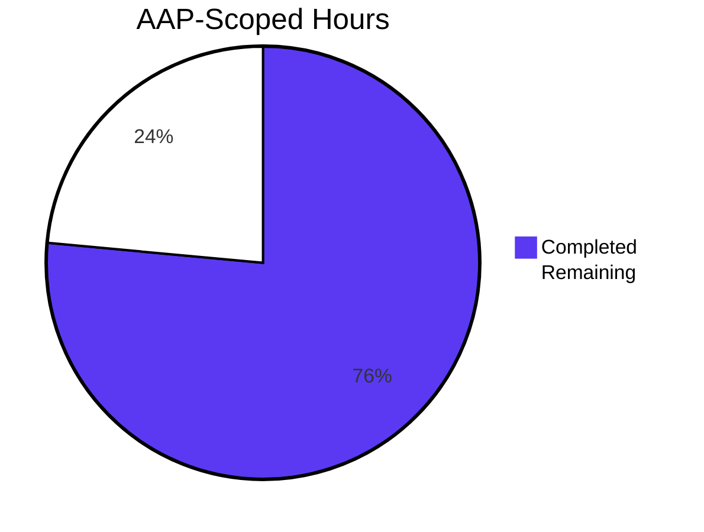
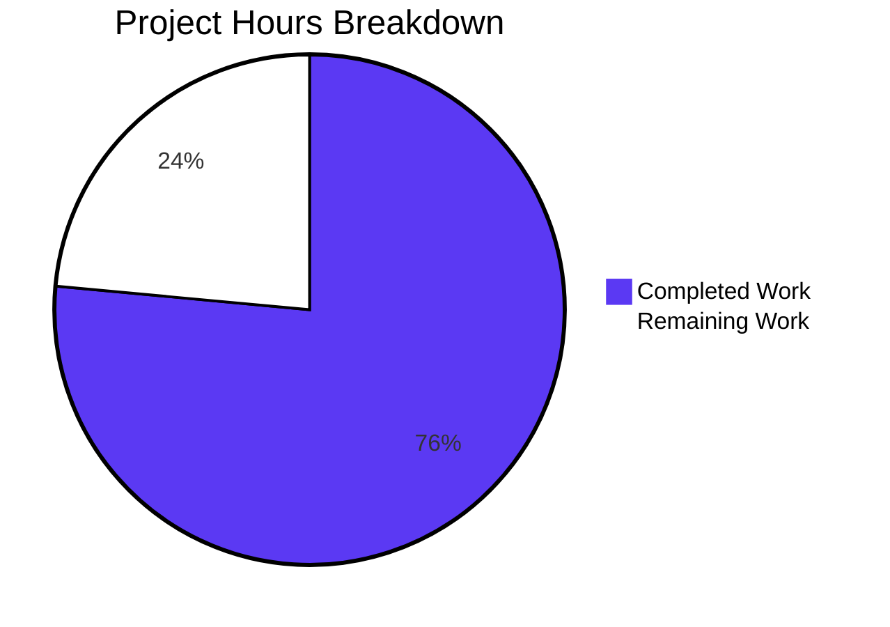

# 1. Executive Summary

## 1.1 Project Overview

A self-contained Node.js tutorial that teaches by demonstration: one process starts an HTTP server, serves one route, and answers `GET /hello` with the eleven bytes `Hello world`. The audience is a developer learning how Node.js receives a request and returns a response, and the reviewer who wants a documented contract executed end to end. It uses only `node:http` and `node:test` — no framework, no declared dependency, no build step — and ships as seven tracked files: two source modules, a four-test suite, an eleven-step README, a manifest, a lockfile and an ignore file.

## 1.2 Completion Status



Completed = Dark Blue (#5B39F3); Remaining = White (#FFFFFF).

| Metric | Hours |
| --- | --- |
| Total Hours | 34 |
| Completed Hours (Baseline: Human with agentic-assist) | 26 |
| Remaining Hours | 8 |

**76.5% complete** — 26 ÷ (26 + 8) = 76.5%. The remaining hours are four confirmation and documentation gaps, not missing functionality.

## 1.3 Key Accomplishments

- [x] `GET /hello` answers `200`, `text/plain; charset=utf-8`, `Content-Length: 11`, body `Hello world`.
- [x] Other paths are `404`; other methods are `405` with `Allow: GET`; query strings change nothing.
- [x] Unparseable request targets such as `GET //` reach the `404` row instead of ending the process.
- [x] One startup line naming the bound port; readable exit `1` for a malformed or occupied port.
- [x] Four `node:test` tests over real TCP on an OS-assigned port: 4 passed, 0 failed.
- [x] Zero declared dependencies; `npm install` fetches nothing.
- [x] Eleven-step README whose commands and transcripts reproduce exactly on macOS and Linux.
- [x] Seven tracked files, each carrying the explanatory comments a beginner needs.

## 1.4 Critical Unresolved Issues

Four items remain open — 4 of the 4 the delivered tutorial carries, and 0 against the endpoint's own behaviour. None blocks the `/hello` contract or the Linux path: the open items concern confirming the tutorial on other platforms and runtime lines, pinning one branch with a test, and documenting one message.

| Issue | Impact | Owner | ETA |
| --- | --- | --- | --- |
| The tutorial has never been run on Windows or macOS; both PowerShell forms are unexecuted | The cross-platform claim rests on documentation, not on a run | Developer with a Windows or macOS host | 3h |
| The rejected-request-target branch (`GET //` → `404`) has no automated test | A change to the parse step could regress it unnoticed | Backend developer | 3h |
| Node.js 24.x and 26.x are admitted by the manifest but only 22.23.5 has run the suite | Two admitted runtime lines are unconfirmed | Backend developer | 1h |
| The refusal message for a malformed `PORT` is not described in the README | A reader can trigger a correct message the tutorial never introduces | Technical writer | 1h |

## 1.5 Access Issues

No access issues identified. The project needs no credential, service, database or third-party API; `PORT` is the only optional variable.

## 1.6 Recommended Next Steps

1. **[High]** Run the tutorial on a Windows and a macOS host, including both PowerShell forms.
2. **[Medium]** Add a test that sends a raw `GET //` target and asserts the `404` row; update the quoted pass counts.
3. **[Medium]** Run `npm test` and the `/hello` check on Node.js 24.x and 26.x.
4. **[Low]** Add one sentence to README step 10 describing the malformed-`PORT` refusal.
5. **[Low]** Decide whether the plan's approximate line counts are guidance or a cap (see 5.2).

# 2. Project Hours Breakdown

## 2.1 Completed Work Detail

| Component | Hours | Description |
| --- | --- | --- |
| Project scaffold | 2 | Manifest with the module system, `engines.node >=22.0.0` and the two scripts; committed lockfile recording the empty dependency set; ignore rules for `node_modules/` and npm crash logs (AAP §0.5.5, §0.9.1). |
| HTTP application module | 6 | `src/app.js`: `createApp()` returning an unstarted server, the three-branch routing table, the request-target parse guard, and `sendText()` with explicit `Content-Type`, `Content-Length` and header merging (AAP §0.6.1 A, §0.5.2). |
| Process bootstrap | 4 | `src/server.js`: port resolution from `PORT` with the `3000` default, the validity guard, the loopback bind, the single startup line and the two readable startup-failure paths with exit code 1 (AAP §0.6.1 B, NFR7). |
| Contract verification suite | 3 | `test/app.test.js`: four `node:test` tests over real TCP against the shipped factory on port `0`, with `before`/`after` lifecycle so no listener leaks (AAP §0.6.1 C, §0.5.4). |
| Tutorial documentation | 8 | `README.md`: the eleven ordered steps, every command with its expected output, the `404`/`405` transcripts, the seven-file table, both shell forms and the sanctioned absences (AAP §0.5.3, FR4, FR5). |
| Explanatory comments and style pass | 3 | The eight mandated comment points, the `createApp()` JSDoc and `sendText()` responsibility comment, and the 80-column wrap across all sources and the manifest (AAP §0.5.3, §0.12.1, §0.12.2). |
| **Total** | **26** | |

## 2.2 Remaining Work Detail

| Category | Hours | Priority |
| --- | --- | --- |
| Windows and macOS execution of the documented tutorial, including both PowerShell forms (NFR1; README steps 2-10) | 3 | Medium |
| Automated test for the rejected-request-target branch, with the README's quoted pass counts updated (the one routing outcome no shipped test reaches) | 3 | Medium |
| Node.js 24.x and 26.x run of `npm test` and the contract check (the manifest admits them) | 1 | Low |
| README step 10 sentence describing the malformed-`PORT` refusal a reader can trigger | 1 | Low |
| **Total** | **8** | |

## 2.3 Hours Reconciliation

- Completed hours: 2 + 6 + 4 + 3 + 8 + 3 = **26** (matches Section 2.1's total and Section 1.2's Completed Hours).
- Remaining hours: 3 + 3 + 1 + 1 = **8** (matches Section 2.2's total and the Remaining Work value in Sections 1.2 and 7).
- Total project hours: 26 + 8 = **34** (matches Section 1.2).
- Completion: 26 ÷ 34 × 100 = **76.5%**.
- Scope: every hour above traces to an Agent Action Plan requirement or to the shipping state that plan defines — the seven files, the endpoint contract, the four-test proof and the tutorial. No hour is counted for work the plan excludes: no deployment target, CI pipeline, container, database, authentication or linting is in scope, so none appears in either column.

# 3. Test Results

Executed first-hand on this checkout with Node.js v22.23.5 and npm 11.21.3: `npm test` (which runs `node --test`) reported `# tests 4`, `# pass 4`, `# fail 0`, `# cancelled 0`, `# skipped 0`, exit 0, in 129.7 ms. The same four tests run alone with `node --test test/app.test.js` reported the same counts in 124.4 ms.

| Area / Category | Framework | Tests | Passed | Failed | Coverage | What This Proves |
| --- | --- | --- | --- | --- | --- | --- |
| Success contract — `GET /hello` | `node:test` + global `fetch` over real TCP | 1 | 1 | 0 | Not measured (no coverage instrumentation in the project) | Status `200`, the `text/plain; charset=utf-8` header read directly from the response, and a body exactly equal to `Hello world` with no newline. |
| Method mismatch — `POST /hello` | `node:test` + `fetch` | 1 | 1 | 0 | Not measured | The same path with a different method answers `405`, carries `Allow: GET`, and returns the body `Method Not Allowed`. |
| Unknown path — `GET /not-hello` | `node:test` + `fetch` | 1 | 1 | 0 | Not measured | A path that is not `/hello` answers `404` with the body `Not Found` rather than a hang or an empty socket. |
| Query tolerance — `GET /hello?name=world` | `node:test` + `fetch` | 1 | 1 | 0 | Not measured | Only the pathname is matched, so a query string leaves the status and the eleven-byte body unchanged. |
| **Total** | `node:test` (`npm test`) | **4** | **4** | **0** | Not measured | The routing table's four documented outcomes, asserted against the real listening server rather than a mocked request object. |

The suite binds port `0` on `127.0.0.1` and addresses the URL from `server.address().port`, so it exercises the shipped handler on an OS-assigned port and cannot collide with a server a reader has running.

## Not Covered

- **Rejected request targets.** `GET //`, `GET *` and `GET ///` are answered `404` and the process survives, but no shipped test reaches that branch: a `fetch` client cannot emit such a request target. Verified by hand with raw socket requests only.
- **Startup behaviour.** The port resolution, the startup line's text, the malformed-`PORT` refusal and the occupied-port message have no automated test; all four were exercised by launching the server directly.
- **Documented-but-untested contract details.** Path-before-method ordering, the `HEAD /hello` outcome, `Content-Length` framing, and `Content-Type` on the `404`/`405` rows are specified and were verified over the wire, but the four-test suite asserts none of them directly.
- **Idempotency and concurrency.** Repeated identical responses were observed, but no test asserts repeatability and no concurrent-load test exists.
- **Platforms and runtime lines.** The suite has run only on Linux with Node.js 22.23.5; Windows, macOS, and the 24.x and 26.x lines the manifest admits are unverified.
- **Coverage, lint and security gates.** None exists by design, so there is no coverage percentage, no linter result and no dependency audit beyond `npm install` reporting zero vulnerabilities on an empty dependency set.

Before release, a human should run the suite on each platform and runtime line the README and manifest claim, and add the one test that would pin the rejected-target branch.

# 4. Runtime Validation & UI Verification

Every flow below was driven against the server on this checkout.

- ✅ **Start-up, default port** — `node src/server.js` printed `Listening on http://localhost:3000` and answered immediately; under `npm start` the same line follows npm's own two-line banner.
- ✅ **Start-up, port override** — `PORT=30555 npm start`, `PORT=30556 npm start` and `PORT=8080 node src/server.js` each printed a line naming the port the socket bound, and each answered on it.
- ✅ **Success contract** — `GET /hello` over `curl -i` returned `HTTP/1.1 200 OK`, `Content-Type: text/plain; charset=utf-8`, `Content-Length: 11`, and a body of exactly `Hello world` (11 bytes, no trailing newline, confirmed with `od -c`).
- ✅ **Browser client** — the same URL in a headless browser loaded as `text/plain`, rendered exactly `Hello world`, contained zero `<script>` elements, and produced zero JavaScript errors.
- ✅ **Unknown-path branch** — `/nope`, `/hello/`, `/Hello` and raw request targets `//`, `*`, `///` each returned `404 Not Found` with a 9-byte body; the process kept serving and answered the next `/hello` with `200`.
- ✅ **Method-mismatch branch** — `POST /hello` returned `405 Method Not Allowed` with `Allow: GET` and an 18-byte body; `HEAD /hello` returned `405` with the same headers and the body suppressed by Node.
- ✅ **Query tolerance** — `/hello?name=world` returned `200` and the same eleven bytes, in curl and in the browser.
- ✅ **Loopback-only exposure** — `ss -ltn` showed a single listener on `127.0.0.1:<port>` and nothing on `0.0.0.0` or `[::]`.
- ✅ **Startup failure paths** — `PORT=abc` exited `1` with one stderr line naming `PORT`'s required range; a second instance on an occupied port exited `1` with `Port <port> is already in use. …`; neither printed a stack trace.
- ⚠ **Windows PowerShell forms** — the status check at `README.md:135` and the `PORT` override at `README.md:237` are present and correctly quoted, but cannot be executed on this Linux host (no `cmd.exe`, no PowerShell, no `NUL` device), so their runtime outcome is unconfirmed.

**Never exercised at runtime:** any command on Windows or macOS; the suite or the endpoint on Node.js 24.x or 26.x; any concurrent or sustained load beyond sequential requests. There are no external integrations to exercise — the project calls no service, holds no database and reads no credential — and a browser's implicit `/favicon.ico` probe is answered by the documented catch-all `404`.

# 5. Compliance & Quality Review

## 5.1 Compliance Matrix

| Deliverable | Benchmark applied | Status | Progress |
| --- | --- | --- | --- |
| `GET /hello` response contract | Status, headers and body exactly as specified; consumable by curl, `fetch` and a browser | PASS | 🟦 Complete |
| Routing table | `404` for other paths, `405` + `Allow: GET` for other methods, query ignored, exact match | PASS | 🟦 Complete |
| Request-target resilience | Every request that reaches the listener is answered; the process survives unusual targets | PASS | 🟦 Complete |
| Process bootstrap and startup failure | `PORT` with a `3000` default, loopback bind, one startup line, readable exit `1` on failure | PASS | 🟦 Complete |
| Application / process separation | Factory returns an unstarted server; only the entry point touches the process | PASS | 🟦 Complete |
| Verification suite | Four tests over real HTTP on an ephemeral port, all passing, no leaked listener | PASS | 🟦 Complete |
| Tutorial accuracy on macOS/Linux | Every command copy-pasteable with its output reproduced beside it | PASS | 🟦 Complete |
| Dependency posture | No declared dependency; lockfile records the empty set; ignore rules effective | PASS | 🟦 Complete |
| Style and explanatory comments without a linter | Two-space, semicolons, single quotes, no line over 80 columns, comments at every mandated point | PASS | 🟦 Complete |
| Scope boundary | Nothing outside the seven planned files; every exclusion disclosed in the tutorial | PASS | 🟦 Complete |
| Cross-platform execution | Documented commands run on Windows and macOS | PARTIAL | ⬜ Windows/macOS unrun |
| Admitted runtime lines | Suite and contract confirmed on Node.js 22, 24 and 26 | PARTIAL | ⬜ 24/26 unrun |

## 5.2 AAP & Rule Divergences and Gaps

No user-specified rules exist for this project, so every row below is a departure from the Agent Action Plan — none is a rule violation, and none blocks release.

| What the AAP Required | What Was Delivered Instead | Why It Diverged | Impact | Remediation |
| --- | --- | --- | --- | --- |
| Derive the pathname with `new URL(req.url, 'http://localhost')` (§0.3.2, §0.6.1 A), with no request-level `try`/`catch` and no `500` path (§0.8.2) | The same derivation, gated by `URL.canParse(...)`, so a target the parser rejects yields `undefined` and takes the existing `404` branch (`src/app.js:21-23`) | The prescribed expression throws `ERR_INVALID_URL` for targets Node's parser delivers (`//`, `///`, `//[`, `http://`), which would end the process and contradict §0.5.2's "covers every request that reaches the server"; the guard was the only route that stayed inside §0.8.2 | No documented row changes; every branch answers byte-identically; no dependency added | None required |
| Print `Listening on http://localhost:${port}` — the configured port — on `listening` (§0.6.1 B) | Print the port the socket bound, `server.address().port` (`src/server.js:43`) | For `PORT=0` the configured value names a URL no client can open; the bound value is the URL the same section tells the reader to open | Identical text for the default 3000 and every explicit non-zero override; only the `PORT=0` case differs, and it differs correctly | None required |
| Resolve the port with `Number(process.env.PORT ?? 3000)` and handle startup failure through the `error` listener (§0.6.1 B) | The pinned resolution line kept verbatim, plus an integer/range guard before `listen()` that refuses an unusable value with one readable line and exit `1` (`src/server.js:12-20`) | `net.Server.listen()` validates the port synchronously and throws `ERR_SOCKET_BAD_PORT` for `NaN` or an out-of-range value, so the `error` listener could never supply NFR7's readable message for a mistyped `PORT` | `PORT=abc` exits `1` with a sentence naming the range rather than a stack trace; an empty `PORT` still resolves to `0`, as the pinned expression dictates | None required |
| Intended file sizes of ~35 (application), ~20 (bootstrap), ~40 (suite) and twelve lines (manifest), §0.5.3 and §0.5.5 | 55, 48, 56 and 14 lines | The explicit no-wrapped-line rule plus the mandated comment points, the JSDoc obligation and the pinned error message text cannot fit inside those figures; the sizes are stated as intended, not as caps | Readability only; every file remains a single-sitting read, and no behaviour or interface is affected | Decide whether the figures are guidance or a cap — no code change keeps the mandated comments |
| The suite's only `await` is on `fetch`; no callback wrapped in a promise Node already provides (§0.12.1) | The `before` hook awaits a hand-built promise around `listen()`'s callback (`test/app.test.js:13-16`) | §0.6.1 C fixes the test's import list at `node:test`, `node:assert/strict` and the application module, which excludes `events.once`; the callback wrapper is the only way to learn the assigned port before the tests run | None; the hook is the canonical listen-wrapping idiom and the suite leaves no listener behind | None required |
| `npm start` prints one line and nothing else (§0.5.4) | The program prints one line, and the README states that npm echoes its own script banner above it (`README.md:67`) | The `start` script value is pinned as exactly `node src/server.js` (§0.5.1), so the banner cannot be suppressed without departing from the manifest; the tutorial therefore describes what a reader actually sees | The documentation is more accurate than the plan's phrasing, and a reader is not misled by the banner | None required |
| The eleven fixed README steps, with no content the plan does not set out (§0.5.3) | Three additive passages: a PowerShell form of the one-line status check (`README.md:135`), a paragraph scoping the shell the commands are written for (`README.md:29-34`), and the `127.0.0.1` fallback clause (`README.md:74-78`) | The tutorial brings Windows into scope and the requirements demand copy-pasteable commands; the fallback clause covers hosts where `localhost` resolves to `::1` before the bound IPv4 interface | A stronger portability claim, but the Windows command itself has never been executed here | Confirm the Windows passage on a Windows host (2.2) |
| Nothing in the plan sets out a step for an unusable `PORT` | README steps 7 and 10 never mention the refusal message (`src/server.js:12-20`) a reader can trigger | The step list is fixed at eleven, and none of them covers startup configuration errors; every existing sentence stays literally true | A reader who mistypes `PORT` meets a correct but unannounced message | Add one sentence to step 10 (1h) |

**Request-target parse guard (`src/app.js:21-23`).** Node hands the listener request targets the WHATWG parser refuses — `curl http://127.0.0.1:3000//` is enough. With the prescribed bare parse, such a target would throw before any response is written and take the process with it, contradicting the routing table's own claim to answer every request. The guard keeps the mandated derivation for every target it can parse and sends the rest to the same `404` row, adding no `try`/`catch`, no `500` path and no dependency. The decision a human owns is documentary: whether the plan's wording should name the guard, so a later change cannot restore the throw.

**Bound-port startup line (`src/server.js:43`).** For the two ports the tutorial documents — 3000 and an explicit override such as 8080 — the configured and bound values are the same, so the printed text matches the plan exactly. They differ only when `PORT=0` or an empty `PORT` lets the operating system choose, and there the plan's literal form would print `http://localhost:0`, a URL no client can open, while the delivered form prints the address that answers `200`. A reviewer comparing the plan to the code should note the line is one deliberate word away from the specification, and that the difference is invisible unless a port of `0` is requested.

**Malformed-port guard (`src/server.js:12-20`).** The plan pinned how the port is resolved and how a startup failure is reported, but not what happens to a value that is not a port number. `listen()` rejects such a value by throwing during the call, before the registered `error` listener can fire, so without a guard a mistyped `PORT` surfaces as a Node stack trace instead of the readable message the non-functional requirement promises for startup failure. The guard sits immediately after the untouched resolution line and refuses the value in the same shape as the occupied-port path. A human should confirm the guard is wanted rather than the stack trace, since it is the only added code in the bootstrap that the plan does not name.

**File sizes against the intended figures (§0.5.3, §0.5.5).** The four hand-written files run past the sizes the plan suggests as intended: the application module at 55 lines, the bootstrap at 48, the suite at 56, the manifest at 14. The excess is entirely the content the same plan mandates — the eight explanatory comment points, the JSDoc contract on the factory, the pinned error messages, and the no-wrapped-line rule that forces long comments onto extra lines. Nothing can be removed without deleting documentation the plan requires, so the figure yields. The decision for a human is whether those numbers are guidance or a cap; if a cap, the plan and its comment doctrine have to be reconciled first.

**Undocumented `PORT` refusal (`README.md`, steps 7 and 10).** The bootstrap refuses a `PORT` that is not a whole number in range with a clear sentence, but the tutorial never introduces that message: the eleven fixed steps contain no startup-configuration error, and step 11 lists what the project does not include rather than what it rejects. The gap costs a reader nothing about the endpoint, and it is one sentence away from closing: step 10 is where a reader changes the port, so it is where the refusal belongs.

**Unexecuted Windows passage (`README.md:135`).** The tutorial's portability claim reaches Windows — the shell-scope paragraph, the `curl.exe` alias warning and the PowerShell status check are all in place — but no Windows host has been available, so that command's runtime outcome rests on curl's and PowerShell's own documented behaviour rather than on a run. Its flags match the POSIX counterpart that was executed and printed `200`. A reviewer signing off the portability claim should execute that command, and the `$env:PORT=8080; npm start` form beside it, before treating Windows as supported.

# 6. Risk Assessment

| Risk | Category | Severity | Probability | Mitigation | Status |
| --- | --- | --- | --- | --- | --- |
| The rejected-request-target branch is pinned only by hand-run checks, so a change to the parse step could regress it without any test failing | Technical | Medium | Medium | Add a test that sends a raw `GET //` target to the in-process server and asserts the `404` row; update the pass counts quoted in the tutorial | Open |
| The tutorial has never been run on Windows or macOS, so the portability claim rests on documentation rather than on a run | Integration | Medium | Medium | Execute the eleven steps on a Windows host and a macOS host, including both PowerShell forms | Open |
| The manifest admits Node.js 24.x and 26.x but only 22.23.5 has run the suite | Technical | Low | Low | Run `npm test` and the `/hello` check once on each admitted LTS line | Open |
| A reader who mistypes `PORT` meets a correct refusal the tutorial never introduces | Operational | Low | Low | One sentence in step 10 naming the range and the message | Open |
| No coverage, lint or CI gate exists, so documented-but-untested behaviours (path-before-method, `HEAD`, `Content-Length` framing) rely on review alone | Technical | Medium | Medium | Accepted by the plan's scope: the four-test bar is deliberate, and the gaps are named in Section 3 so a future change is reviewed against them | Accepted |
| The startup line names `localhost` while the socket binds `127.0.0.1`, so a client that resolves `localhost` to `::1` first may fail to connect | Integration | Low | Medium | The tutorial already gives `http://127.0.0.1:3000/hello` as the fallback and explains why | Mitigated |
| `process.exit(1)` immediately after `console.error` can truncate the message when stderr is a pipe | Operational | Low | Low | Use `process.exitCode = 1` and let the process end naturally if the message ever needs to be piped | Accepted |
| WHATWG normalisation routes protocol-relative, absolute-form and dot-segment targets to the `200` branch, and there is no authentication or rate limiting | Security | Low | Low | The body is a constant, no request-derived value reaches a sink, and the listener is bound to loopback only | Accepted |

**Security posture.** The attack surface is one loopback socket serving three constant strings. No credential is accepted or stored, no request body or header is parsed, no filesystem path or command derives from input, and no third-party code exists to audit — the committed lockfile records an empty dependency set. Exposure is bounded by the `127.0.0.1` bind and by the absence of any state to corrupt. The residual risks above are availability and maintenance concerns, not confidentiality ones.

**Operational posture.** There is no deployment target, process manager, log aggregation or health endpoint in scope, so operational risk is limited to the two failure modes the bootstrap handles: a malformed port and an occupied port, both of which exit non-zero with a single readable line. Recovery is a restart with a valid `PORT`.

# 7. Visual Project Status



Completed Work = Dark Blue (#5B39F3); Remaining Work = White (#FFFFFF). The chart reads 26 of 34 hours, the same figures as Sections 1.2 and 2.2.

**Remaining hours by category**

| Category | Hours | Priority |
| --- | --- | --- |
| Cross-platform execution of the tutorial | 3 | Medium |
| Automated coverage of the rejected-target branch | 3 | Medium |
| Node.js 24.x / 26.x confirmation | 1 | Low |
| Tutorial sentence for the `PORT` refusal | 1 | Low |
| **Total remaining** | **8** | |

**Status by capability** — every capability the plan scoped is built; the two that are not fully confirmed have been exercised on one platform and one runtime line.

| Capability | Built | Verified at runtime |
| --- | --- | --- |
| `GET /hello` contract | 🟦 Yes | 🟦 Yes |
| `404` / `405` routing branches | 🟦 Yes | 🟦 Yes |
| Query tolerance and exact matching | 🟦 Yes | 🟦 Yes |
| Rejected request targets | 🟦 Yes | 🟦 By hand only |
| Port resolution and startup failure paths | 🟦 Yes | 🟦 Yes |
| Four-test suite | 🟦 Yes | 🟦 Yes |
| Eleven-step tutorial | 🟦 Yes | 🟦 Yes on macOS/Linux · ⬜ Windows, macOS unrun |
| Zero-dependency manifest and lockfile | 🟦 Yes | 🟦 Yes |

# 8. Summary & Recommendations

**What was delivered.** A complete, runnable Node.js tutorial: two source modules that serve exactly one route, a four-test suite that proves the contract over real TCP, an eleven-step README that prints the expected output beside every command, and a manifest that declares no dependency at all. The endpoint behaves as requested — `GET /hello` answers `200` with `text/plain; charset=utf-8`, `Content-Length: 11` and the eleven bytes `Hello world` — and it does so over curl, `fetch`, a raw socket and a browser. The surrounding behaviour a learner will meet is equally real: `404` for any other path, `405` with `Allow: GET` for any other method, query strings ignored, and an unparseable request target answered rather than allowed to kill the process.

**What was verified.** The suite was executed on this checkout and reported 4 tests, 4 passed, 0 failed. The four documented routing outcomes were re-driven over the wire, the browser client was exercised on four URLs with no JavaScript errors, the loopback-only bind was confirmed from the socket table, and both startup failure paths were reproduced with exit code `1` and a single readable line. Section 4 lists each flow with its outcome; Section 3 names the categories no test reaches.

**Where it stands.** At **76.5%** on the AAP-scoped hours calculation — 26 completed hours against 8 remaining — the remaining work is confirmation rather than construction: run the tutorial on Windows and macOS, run the suite on the Node.js lines the manifest admits, pin the rejected-target branch with a test, and add the one sentence that introduces the port refusal. Sections 1.4 and 2.2 carry the same four items, and Section 5.2 records the eight places where the delivered code deliberately differs from the plan's letter, each with the reason it does.

**Recommendations.** Treat the Windows and macOS run as the release gate for the tutorial's portability claim, because that is the only claim in the project currently resting on documentation alone. Add the rejected-target test before the parse step is touched again, and update the pass counts the tutorial quotes in the same change so the documentation stays true. Beyond that, resist the temptation to grow the project: its value is that seven files and zero dependencies demonstrate the whole HTTP transaction, and every gate or framework added would teach something other than that.

| Metric | Value |
| --- | --- |
| AAP-scoped completion | 76.5% (26 of 34 hours) |
| Requirements met | 27 of 29 fully met, 2 partially (platform and runtime-line confirmation) |
| Automated tests | 4 executed, 4 passed, 0 failed |
| Declared dependencies | 0 |
| Tracked files | 7 |
| Open items | 4, none blocking the endpoint contract |

**Production readiness.** Ready for the reader the project was written for, on macOS and Linux with Node.js 22: install, start, call and test all work as the tutorial describes, and the failure paths behave. Not yet signed off for the Windows claim it makes in print, and not yet exercised on the two newer LTS lines the manifest admits — both cheap to close, both named above.

# 9. Development Guide

Every command below was run on this checkout with Node.js v22.23.5 and npm 11.21.3, from the repository root.

## 9.1 System prerequisites

- **Node.js** 22.0.0 or newer — the floor `package.json` declares (`"node": ">=22.0.0"`). Check it with `node -v`; anything from `v22.0.0` upward satisfies the floor.
- **npm** — ships with Node.js. Check it with `npm -v`.
- **An HTTP client** — `curl`, or a browser address bar. No other tool, database, container runtime or package manager is needed.

There is no build step, no compiler, no native module and no configuration directory.

```bash
node -v          # v22.23.5 on this host
npm -v           # 11.21.3 on this host
```

## 9.2 Environment setup

None is required. The project reads exactly one optional environment variable, `PORT`, and holds no `.env` file, no secret and no credential. All work happens inside the repository root, which is the directory holding `package.json`.

## 9.3 Install dependencies

```bash
npm install
```

Expected output (npm's own summary; the elapsed time and audit wording vary):

```text

up to date, audited 1 package in 144ms

found 0 vulnerabilities
```

`up to date` is the line proving nothing was fetched. No `node_modules/` directory is created, because the manifest declares no dependency — that is the project's design, not a failed install.

## 9.4 Start the server

```bash
npm start
```

Expected output — npm echoes its own two banner lines, then the program prints one:

```text

> nodejs-hello-tutorial@1.0.0 start
> node src/server.js

Listening on http://localhost:3000
```

The server binds `127.0.0.1:3000` by default and keeps the terminal. To choose another port, set `PORT`:

```bash
PORT=8080 npm start
```

```text
Listening on http://localhost:8080
```

On Windows PowerShell the same override is:

```powershell
$env:PORT=8080; npm start
```

To run the entry point directly, without npm's banner:

```bash
node src/server.js
```

## 9.5 Verify it works

In a second terminal, from the repository root:

```bash
curl -i http://localhost:3000/hello
```

```text
HTTP/1.1 200 OK
Content-Type: text/plain; charset=utf-8
Content-Length: 11

Hello world
```

`Date`, `Connection` and `Keep-Alive` vary per request and per client. A one-line status check:

```bash
curl -s -o /dev/null -w '%{http_code}\n' http://localhost:3000/hello
```

```text
200
```

On Windows PowerShell, where `curl` is an alias for `Invoke-WebRequest`, name `curl.exe` and send the body to `NUL`:

```powershell
curl.exe -s -o NUL -w '%{http_code}\n' http://localhost:3000/hello
```

The two other branches:

```bash
curl -i http://localhost:3000/nope          # 404 Not Found, Content-Length: 9
curl -i -X POST http://localhost:3000/hello # 405 Method Not Allowed, Allow: GET, Content-Length: 18
```

## 9.6 Run the tests

```bash
npm test
```

Expected result:

```text
# tests 4
# suites 0
# pass 4
# fail 0
# cancelled 0
# skipped 0
# todo 0
```

A single file and a syntax check:

```bash
node --test test/app.test.js
node --check src/app.js && node --check src/server.js && node --check test/app.test.js
```

The suite binds port `0`, so it never collides with a server you are running and needs no free fixed port.

## 9.7 Stop the server

`Ctrl+C` in the terminal running it. To confirm the port is free again:

```bash
lsof -ti tcp:3000 -sTCP:LISTEN     # prints nothing when the port is free
```

## 9.8 Troubleshooting

- **`Listening on …` does not appear, or a banner shows above it.** The two lines beginning `>` are npm's script banner, printed before the program runs. The program's own output is the single `Listening on …` line.
- **`Port 3000 is already in use. Set the PORT environment variable to a different port and start again.`** Another process — usually an earlier `npm start` — holds the port. Stop it with `Ctrl+C`, or start on another port with `PORT=8080 npm start`.
- **`PORT must be a whole number between 0 and 65535. …`** The value you exported is not a valid port: `PORT=abc`, `PORT=80.5`, `PORT=70000` and similar all produce this message and exit `1`. Use a whole number in range. An empty or `0` value lets the operating system choose, and the startup line names the port it chose.
- **`curl: (7) Failed to connect` while the server is running.** The documentation uses `localhost`, which some hosts resolve to the IPv6 address `::1` first; the server binds IPv4 loopback. Use `http://127.0.0.1:3000/hello`.
- **The shell prompt reappears on the same line as `Hello world`.** Expected: the body has no trailing newline, deliberately, so the response is exactly eleven bytes.
- **`Cannot find module 'src/server.js'` or a similar path error.** The commands assume the repository root; `cd` to the directory holding `package.json` first.
- **`npm install` creates no `node_modules/`.** Expected: there is nothing to install. `node_modules/` is ignored anyway, so an install that ever downloads something cannot be committed by accident.

# 10. Appendices

## A. Command Reference

| Purpose | Command | Observed result |
| --- | --- | --- |
| Check the runtime and package manager | `node -v` · `npm -v` | `v22.23.5` · `11.21.3` |
| Install (nothing is fetched) | `npm install` | `up to date, audited 1 package`, `found 0 vulnerabilities` |
| Start on the default port | `npm start` | npm banner, then `Listening on http://localhost:3000` |
| Start on a chosen port | `PORT=8080 npm start` | `Listening on http://localhost:8080` |
| Start the entry point directly | `node src/server.js` | `Listening on http://localhost:3000` |
| Call the endpoint | `curl -i http://localhost:3000/hello` | 200, `Content-Type: text/plain; charset=utf-8`, `Content-Length: 11`, body `Hello world` |
| One-line status check | `curl -s -o /dev/null -w '%{http_code}\n' http://localhost:3000/hello` | `200` |
| Trigger the `404` branch | `curl -i http://localhost:3000/nope` | 404, `Content-Length: 9`, body `Not Found` |
| Trigger the `405` branch | `curl -i -X POST http://localhost:3000/hello` | 405, `Allow: GET`, `Content-Length: 18`, body `Method Not Allowed` |
| Run the suite | `npm test` | `# tests 4`, `# pass 4`, `# fail 0` |
| Run one test file | `node --test test/app.test.js` | same four results, ~124 ms |
| Syntax-check the modules | `node --check src/app.js` (and the other two) | exit 0, no output |
| Check the port is free | `lsof -ti tcp:3000 -sTCP:LISTEN` | no output when free |

## B. Port Reference

| Port | Who uses it | Notes |
| --- | --- | --- |
| `3000` | `npm start` / `node src/server.js` default | The port every command in the tutorial uses. Override with `PORT`. |
| Any whole number `1-65535` | `PORT=<n> npm start` | The startup line names the port the socket bound. |
| `0` | `PORT=0 npm start` | The operating system picks a free port; the startup line names the one it chose. |
| OS-assigned (ephemeral) | `test/app.test.js` | The suite binds port `0` on `127.0.0.1`, so it never collides with a running server. |
| Bind address | `127.0.0.1` only | No listener exists on `0.0.0.0` or `[::]`; the server is unreachable from the network. |

## C. Key File Locations

| Path | Contents |
| --- | --- |
| `package.json` | Package identity, `"type": "module"`, `engines.node >=22.0.0`, and the `start` and `test` scripts. No dependency keys. |
| `package-lock.json` | Committed lockfile, `lockfileVersion` 3, recording no package beyond the root. |
| `.gitignore` | `node_modules/` and `npm-debug.log*`. |
| `README.md` | The eleven-step tutorial with the expected output of every command. |
| `src/app.js` | `createApp()` — the routing table, the request-target parse guard and the `sendText()` response helper. Returns a server that is not listening. |
| `src/server.js` | The entry point: port resolution and validation, loopback bind, startup line, startup-failure paths with exit code `1`. |
| `test/app.test.js` | The four `node:test` cases over real HTTP on an ephemeral port. |

## D. Technology Versions

| Component | Version | Source of truth |
| --- | --- | --- |
| Node.js runtime | `>=22.0.0`, no ceiling; verified on 22.23.5 | `package.json` `engines.node`; restated as a checkable line in README step 2 |
| npm | Ships with Node.js; 11.21.3 used here | Not declared — no package requires it |
| Module system | ECMAScript modules via `"type": "module"` | `package.json` |
| HTTP layer | `node:http` (built-in) | `src/app.js` |
| Test runner / assertions | `node:test` and `node:assert/strict` (built-in) | `test/app.test.js` |
| HTTP client in tests | Global `fetch` (built-in, no import) | `test/app.test.js` |
| Declared packages | None | `package.json`, `package-lock.json` |

## E. Environment Variable Reference

| Variable | Required | Default | Effect |
| --- | --- | --- | --- |
| `PORT` | No | `3000` | The port the server listens on. Must resolve to a whole number `0-65535`; anything else exits `1` with a readable message. `0` lets the operating system choose, and the startup line names the chosen port. |

No secret, credential, connection string or service endpoint is read at any point.

## F. Developer Tools Guide

- **Runner:** `npm test` is exactly `node --test`, which discovers `test/**/*.test.js`. Use `node --test test/app.test.js` to run one file, and add `--test-name-pattern='<text>'` to filter by test name.
- **No linter, formatter, coverage tool, TypeScript or bundler exists**, by design. Style is a property of the code: two-space indentation, semicolons, single quotes, one statement per line, no line over 80 columns. `node --check` is the available syntax gate, and `npm install` reporting zero vulnerabilities is the whole dependency audit on an empty dependency set.
- **Debugging:** the server emits no per-request log; the readable record of a request is `curl -i`. Set `PORT=0` and read the startup line when you need a free port without hunting for one.
- **Recommending a change:** add a route to the routing table in `src/app.js`; neither `src/server.js` nor the suite needs to change for a route to be reachable, because both consume the same factory export.

## G. Glossary

- **AAP** — the Agent Action Plan: the specification this project was built against, including its scope boundary and intended behaviours.
- **Factory / composition root** — the split where `createApp()` builds a server without starting it, and `src/server.js` owns the process concerns (port, bind, log line, startup failure).
- **Ephemeral port** — a port the operating system assigns on request (port `0`), used by the test suite so runs never collide.
- **Loopback** — the local interface `127.0.0.1`; the only address the server binds, so it is unreachable from the network.
- **Request target** — the raw value in the request line (`/hello?name=world`), from which only the pathname is compared.
- **Framing** — how the client knows where a response body ends. This project sets `Content-Length` explicitly, so responses are framed by length rather than chunked.
- **`EADDRINUSE`** — the OS error for an occupied port, surfaced as one readable line and exit code `1` rather than a stack trace.
- **AAP-scoped completion** — completed hours divided by completed plus remaining hours, counting only the work the plan scopes and the shipping state it defines.
